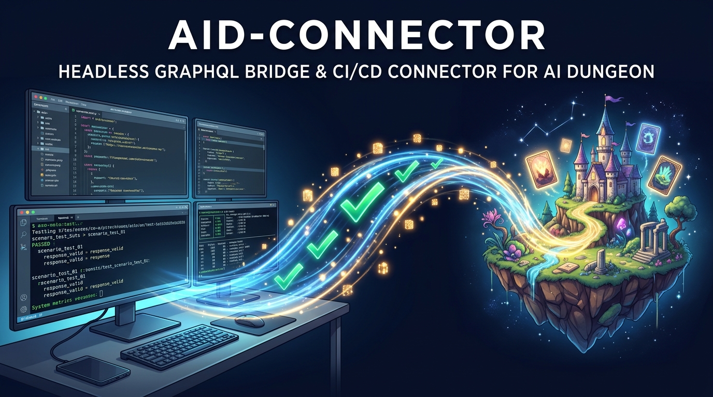

# aid-connector 🧪



<p align="center">
  <strong>Headless Scenario CI/CD, Regression Testing Harness, and Developer Bridge for AI Dungeon QuickJS Scripts</strong>
</p>

<p align="center">
  
  
  
  
</p>

---

> [!IMPORTANT]
> **Unofficial Community Developer Tool**  
> `aid-connector` is an open-source testing harness created by scenario authors for scenario authors. It is an independent community project and is **not affiliated with, endorsed by, or maintained by Latitude**.
>
> **Responsible Platform Use:**  
> This toolkit is designed strictly for scenario development, QuickJS script verification, and automated regression testing on **private / unlisted** testbeds. It is **not** an auto-player, gameplay bot, or content scraper. All scenario updates use `updateTier: "SILENT"` to avoid polluting public discovery feeds, and test runs are tightly bounded to minimal assertion turns. Always respect Latitude's [Terms of Service](https://aidungeon.com/terms) and community guidelines.

---

## Why `aid-connector`?

Building complex scenario scripts for AI Dungeon—such as POSIX command parsers ([`aid-getopt`](https://github.com/viosca/aid-getopt)), autonomous lore engines ([`Entity-Cards`](https://github.com/viosca/Auto-Cards)), and character minds ([`Inner-Self`](https://play.aidungeon.com/profile/Random_Variable))—requires verifying intricate multi-script waterfalls:
- Does an upstream command router intercept `/diag` and halt before downstream scripts run?
- Does `stop = true` cleanly prevent LLM token generation?
- Does autonomous background Named Entity Recognition (NER) inject story cards under `World Lore:` deterministically?
- Does scenario state persist across turns without colliding between attached scripts?

Testing these behaviors manually in the web UI requires dozens of repetitive clicks, manual script copy-pasting, and inspecting raw browser dev tools. 

**`aid-connector` is Jest / Playwright for AI Dungeon scenario scripting.** It provides a headless GraphQL harness to programmatically deploy testbed scenarios, run targeted assertion turns, inspect `gameState`, and verify multi-script pipelines in seconds.

---

## Features

- ⚡ **Headless Scenario Deployment:** Programmatically creates test scenarios and uploads QuickJS script tabs (`onInput`, `onModelContext`, `onOutput`, `sharedLibrary`).
- 🔗 **Waterfall Multi-Script Testing:** Attaches and chains multiple scenario scripts to verify execution order, state scoping, and command passthrough.
- 🎯 **Deterministic Context Telemetry:** Captures and inspects the raw prompt payload passed into `onModelContext` to verify story card injection and formatting.
- 🛡️ **Platform-Safe Defaults:**
  - All test scenarios created as unlisted/private (`isPublished: false`).
  - Script uploads default to `updateTier: "SILENT"` (zero feed pollution).
  - Transparent developer `User-Agent`.
  - Tight turn bounds (2–4 assertion turns per test) to prevent unnecessary LLM inference compute.
- 🔒 **Zero-Credential Token Auth:** Authenticates via browser session tokens (`AID_ACCESS_TOKEN`), keeping credentials safe.
- 🌉 **Local Dev Bridge:** Built-in HTTP bridge server on port `8798` allowing local browser extensions to seamlessly sync session tokens.

---

## Quickstart

### 1. Installation

Clone the repository and install dependencies:

```bash
git clone https://github.com/viosca/aid-connector.git
cd aid-connector
npm install
```

### 2. Authentication Setup

Copy the environment template:

```bash
cp .env.example .env
```

Extract your session token from your browser while logged into [play.aidungeon.com](https://play.aidungeon.com):
1. Open DevTools (F12) $\rightarrow$ **Network** tab.
2. Click any action in AI Dungeon and find a request to `graphql`.
3. Copy the `Authorization` header value (omit the `firebase ` prefix).
4. Paste it into your `.env`:

```env
AID_ACCESS_TOKEN=your_token_here
```

Verify your connection:

```bash
npm run verify
```

---

## Running Test Suites

Run the local connectivity and client unit tests:
```bash
npm test
```

Run the **Live Multi-Script Waterfall Regression Suite** (verifies Case 1 built-in routers and Case 3 dual attached scripts):
```bash
npm run test:waterfall
```

Run the **Autonomous NER & Context Injection Suite** (verifies passive entity extraction and model prompt injection):
```bash
npm run test:autonomous
```

---

## Architecture & File Structure

```text
aid-connector/
├── assets/
│   └── aid-connector-banner.jpg   # Project hero banner
├── src/
│   ├── index.js                  # Package entry point
│   ├── client.js                 # AIDClient (GraphQL scenario & adventure methods)
│   ├── auth.js                   # Firebase token management & auth headers
│   ├── config.js                 # Environment config & endpoint definitions
│   └── bridge.js                 # Local Dev Bridge server logic
├── scripts/
│   ├── verify_auth.js            # Connection & user verification tool
│   ├── bridge.js                 # Local Dev Bridge server daemon
│   ├── inspect_adventure.js      # Utility to inspect live adventure gameState
│   ├── create_test_scenario.js   # Sample testbed scenario generator
│   └── publish_dev_*.js          # Automated developer script publisher
├── test/
│   ├── test_connection.js        # Core client unit tests
│   ├── test_waterfall_regression.js # Full multi-script waterfall test suite
│   ├── test_autocards_regression.js # Slash-command card generation suite
│   └── test_autocards_autonomous.js # Passive NER & context injection suite
├── .env.example                  # Environment template
├── package.json
└── README.md
```

---

## Example Usage in Code

```javascript
const { AIDClient } = require("aid-connector");

async function runTest() {
    const client = new AIDClient();

    // 1. Create a private, unlisted test scenario
    const { scenario } = await client.createScenario({
        title: "[TEST] Script CI/CD Scenario",
        description: "Automated regression testing",
        prompt: "The adventure begins in a quiet tavern.",
        scriptsEnabled: true,
        gameCode: {
            sharedLibrary: "// Shared library code...",
            onInput: "const modifier = (text) => { return { text }; }; modifier(text);",
            onModelContext: "const modifier = (text) => { return { text, stop }; }; modifier(text);",
            onOutput: "const modifier = (text) => { return { text }; }; modifier(text);"
        }
    });

    // 2. Play an adventure to run assertion actions
    const { adventure } = await client.playAdventure(scenario.shortId);
    
    // 3. Send a test action
    await client.actionRequest({
        adventureId: adventure.id,
        type: "do",
        text: "/test"
    });

    // 4. Inspect resulting game state
    const state = await client.getGameState(adventure.shortId);
    console.log("Game State:", state);
}

runTest();
```

---

## License

MIT © [Randy Viosca](https://github.com/viosca) ([@Random_Variable](https://play.aidungeon.com/profile/Random_Variable))
